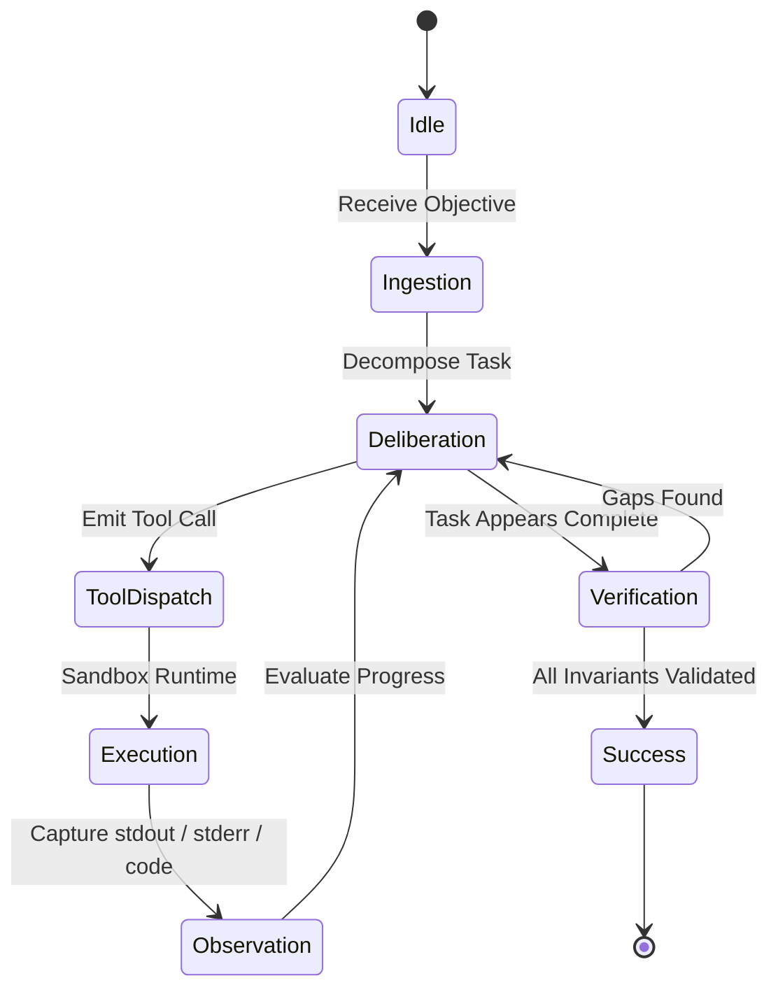

# Tool-Use Protocols and Autonomous Agentic Loop Patterns

## 1. Overview
Autonomous AI agents operate in iterative decision loops (Plan -> Act -> Observe -> Reflect -> Synthesize). This guide formalizes the architectural patterns that ensure agent tool use is reliable, safe, and resilient against execution friction.

---

## 2. The Core Agent Loop State Machine



---

## 3. Tool Definition Best Practices

### A. Minimalist Parameter Surface
Tools should have narrow, orthogonal parameter scopes. Large polymorphic parameter structures cause high LLM error rates.

**Anti-Pattern:**
```json
{
  "name": "manage_server",
  "parameters": {
    "action": "start | stop | restart | edit_config | tail_log",
    "target": "string",
    "params": "object"
  }
}
```

**Production-Hardened Pattern:**
```json
{
  "name": "restart_service",
  "parameters": {
    "service_name": {"type": "string", "description": "Systemd unit name, e.g. nginx.service"}
  }
}
```

---

## 4. Error Handling and Watchdog Self-Healing

1. **Non-Terminating Errors**:
   When a tool call fails, return structured diagnostic logs to the agent instead of throwing an unhandled exception:
   ```json
   {
     "status": "ERROR",
     "exit_code": 127,
     "error_summary": "Command 'git-filter-repo' not found in PATH",
     "suggested_remediation": "Install via `pip install git-filter-repo` or apt"
   }
   ```
2. **Context Retention**:
   Provide the agent with previous failure states to prevent repeated identical attempts (anti-looping guards).
3. **Loop Detection**:
   If an agent issues identical tool calls 3 consecutive times with identical error returns, force an immediate fallback or escalation branch.

---

## 5. Output Parsability & JSON Streams
Autonomous agents integrating with CLI pipelines must support `--json` output flags.
- Text output for humans is ungrounded.
- Pure JSON streams allow downstream orchestration engines to serialize states with zero regex heuristics.
